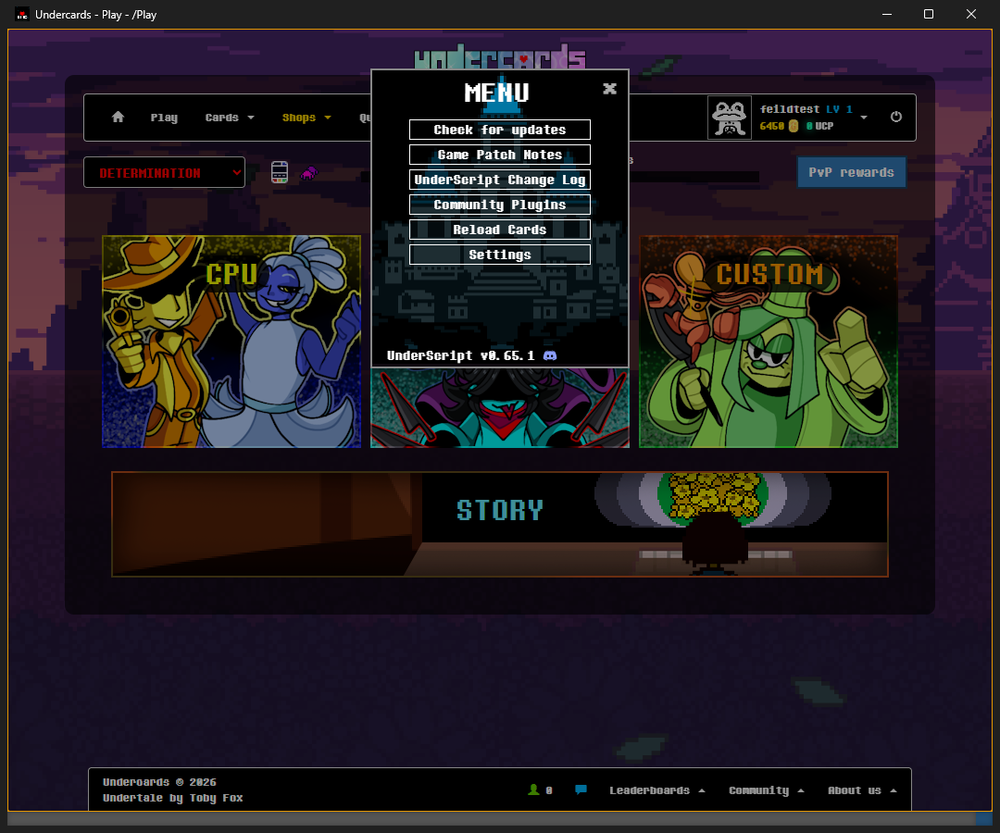
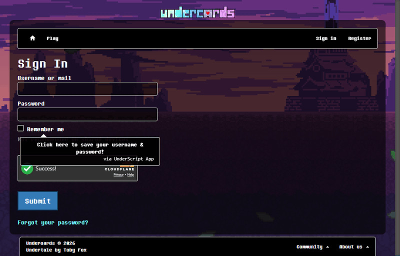
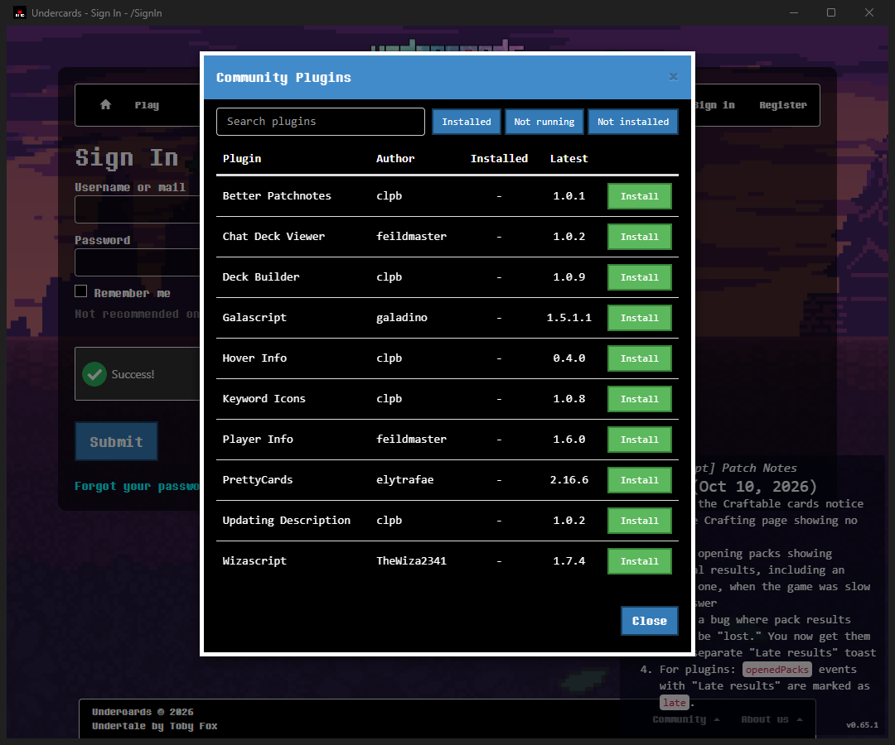
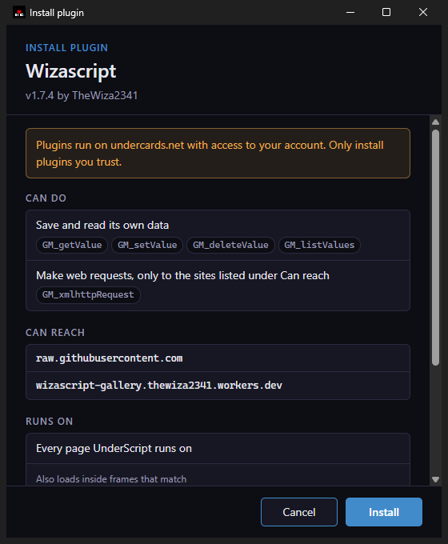
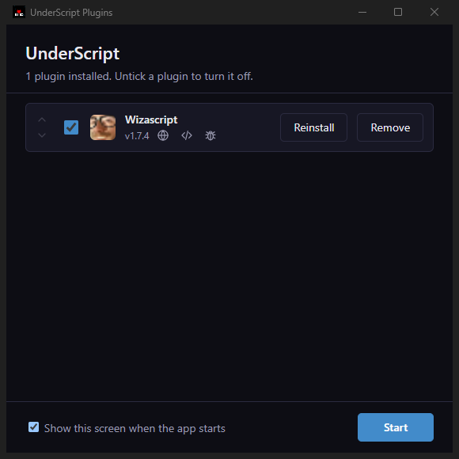

# UnderScript App #

A desktop app for playing [Undercards](https://undercards.net/) with [UnderScript](https://github.com/UCProjects/UnderScript) already built in. There is no browser extension or userscript manager to set up: install the app, sign in, and play.



## Download ##

Get the latest version from the [releases page](https://github.com/UCProjects/UnderScript-App/releases/latest).

| System | File |
| --- | --- |
| Windows | `UnderScript-Setup-<version>.exe` |
| macOS (Apple silicon) | `UnderScript-<version>-arm64.dmg` |
| Linux | `UnderScript-<version>.AppImage` |

On Linux, make the AppImage executable (`chmod +x`) and run it.

The builds are not code-signed, so Windows SmartScreen or macOS Gatekeeper may warn you the first time you open the app. You can approve it from the warning or from your system's security settings.

### Code signing ###

Signing the builds would remove those warnings, but certificates cost money every year, so it is something the community can choose to fund. [Sponsoring on GitHub](https://github.com/sponsors/feildmaster) is turned into FMC at one FMC for every cent, and you spend FMC in the [UnderScript Discord](https://discord.gg/9KPj9XcMY9) to bid on what gets worked on next. Use `/feature-list` to see what people are backing, and `/feature-bid` to put your FMC behind "Code signing" or anything else on the list. If your Discord account isn't linked to your wallet yet, the bot tells you how.

## What you get ##

### Sign in once ###

The first time, sign in as usual and tick "Remember me". The app saves your password in your system's own credential store (Windows Credential Manager, macOS Keychain, or your Linux keyring) and remembers your username. The next time, the sign in page loads with your username and password already filled in.

If you have more than one saved account, type a username and click the password field to fill in that account's password.



### Updates ###

The app downloads its own updates and installs them when you quit, and it brings in the latest UnderScript each time it starts. Plugins are different: nothing is updated until you update from "Pending Updates".

### Plugins without the setup ###

Open the UnderScript menu with Esc, choose "Community Plugins", and click Install on any plugin. Before anything is installed, the app shows what the plugin can do, which sites it can reach, and where it runs.





Plugins you install are listed in the plugin manager. It opens when the app starts, from "Manage plugins" in the right-click menu, or with Ctrl+Shift+P. Use it to turn plugins off, reorder them, reinstall them, or remove them. You can switch off the start screen at the bottom of the window.



### Everything in UnderScript ###

All of UnderScript's features work as they do in a browser, including its settings and the plugin API. See the [UnderScript page](https://underscript.uc.feildmaster.com) for what it does.

## Shortcuts ##

On macOS, use Cmd where this table says Ctrl.

| Shortcut | Action |
| --- | --- |
| Esc | Open the UnderScript menu (not while typing in a field) |
| F5 or Ctrl+R | Reload the page |
| F11 | Toggle fullscreen |
| Alt+Home | Go to the Undercards home page |
| Ctrl+L | Copy the page address |
| Ctrl+Shift+P | Open the plugin manager |
| F12 or Ctrl+Shift+I | Open DevTools |

Right-click anywhere for the app's menu: Home, Copy page address, Toggle fullscreen, Manage plugins and Open DevTools. On the Game and Spectate pages the game uses right-click itself, so hold Shift while you right-click to open the app's menu there.

## Privacy and safety ##

- Your password is only stored if you tick "Remember me", and it lives in your system's credential store, not in a file.
- The app is open source, and the installers are built from this repository by GitHub Actions, so you can read exactly what you are running or [build it yourself](#building-from-source).
- UnderScript is downloaded from its GitHub releases and checked before it runs.
- Plugins can only be installed from the community registry, and each one shows its permissions first.

## Help ##

- Found a bug or want a feature? [Open an issue](https://github.com/UCProjects/UnderScript-App/issues).
- Questions or chat: join the [UnderScript Discord](https://discord.gg/9KPj9XcMY9).
- What changed in each version: [changelog.md](changelog.md).

UnderScript and this app are community projects, not affiliated with Undercards.

## Building from source ##

You'll need [Node.js](https://nodejs.org/) 24.

```sh
git clone https://github.com/UCProjects/UnderScript-App.git
cd UnderScript-App
npm install
npm start
```

`npm run dist` builds an installer for your system into `dist/`.
